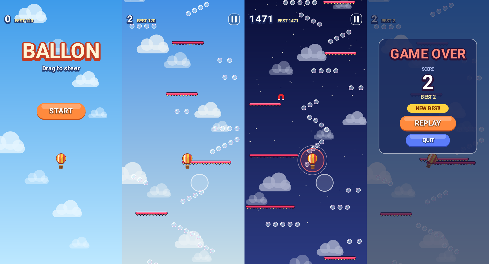

# Ballon

An Android arcade game about piloting a hot air balloon. The balloon climbs on its own; drag a finger anywhere to steer left and right, collect bubbles, dodge the spiked bars, and grab the magnet to pull bubbles in. One hit ends the run. Your best score is saved, and the game works offline.



## How it plays

- **Steer:** drag anywhere; the balloon follows your finger sideways.
- **Bubbles:** 10 points each.
- **Spike bars:** 1 point for each one you pass; touching one ends the run.
- **Magnet:** pulls nearby bubbles toward the balloon for 6 seconds.
- **Speed:** the climb gets faster the longer you survive, and the sky moves from day to sunset to night.

## Build

Requires JDK 17+ and the Android SDK (platform 35).

```
./gradlew assembleDebug        # APK at app/build/outputs/apk/debug/app-debug.apk
./gradlew testDebugUnitTest    # game-rule tests and screenshot renders
```

## Layout

- `app/src/main/java/com/ballon/game/core/` — game rules in plain Kotlin, no Android imports
- `app/src/main/java/com/ballon/game/` — rendering, touch input, screens, saved best score

## Reference

The screen recording in this repository shows the game whose mechanics inspired this one. The art and look here are original.
